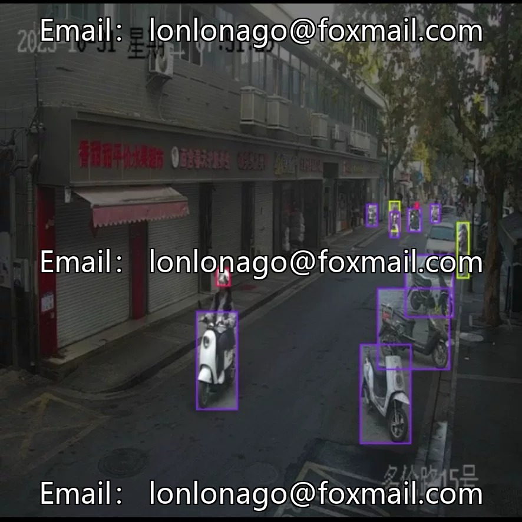
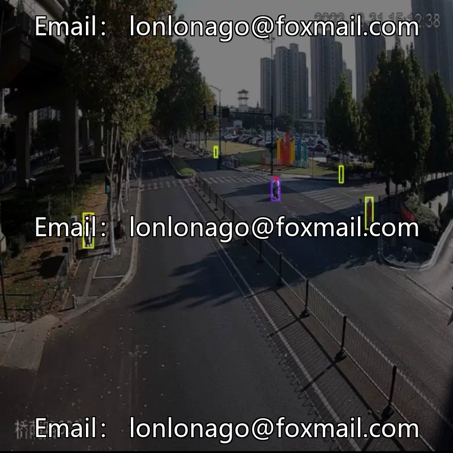
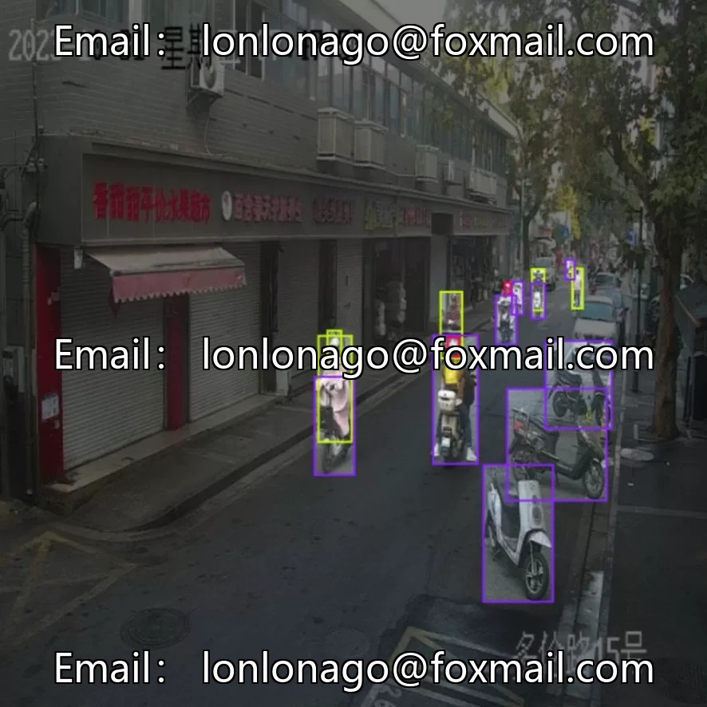
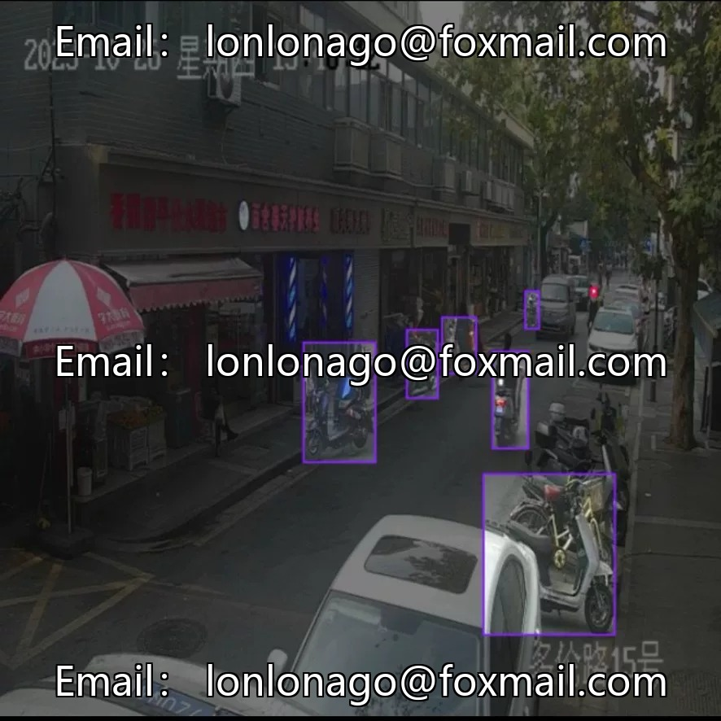

# Non-motorcycle helmet wearing detection dataset

## Body

Non-motorcycle helmet wearing detection dataset
Project number: Item No. 10553

The dataset contains 3,000 real street scenes images, covering helmets, electric bicycles, and unhelmeted targets, suitable for non-motorcycle helmet wearing detection tasks. YOLO format annotation, directly import the mainstream target detection framework for training. The data scenarios are diverse, covering different time periods and road environments, which is suitable for traffic civilization supervision, road safety early warning, smart city construction and other scenarios.

Virtual materials, once sold, are non-refundable.
Interested friends, click "I want" to proceed.

## Images

## Payment

Here is a pay link on Stripe ( https://buy.stripe.com/3cs8yP7sY87d0vu9AB ). Please contact me lonlonago@foxmail.com after funding $89, and I will send you a complete data files , thank you!

